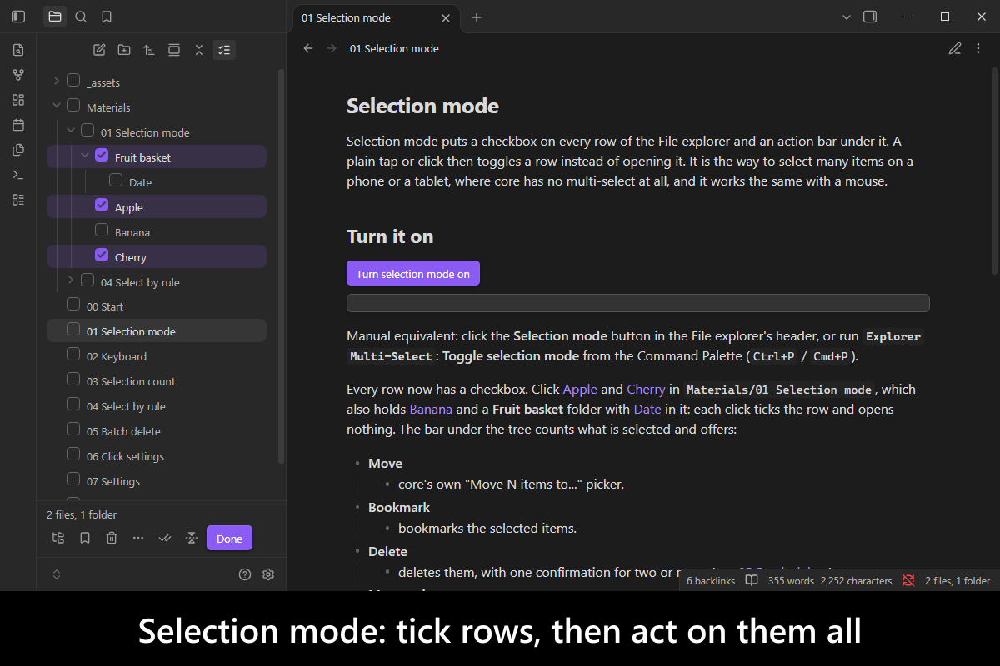
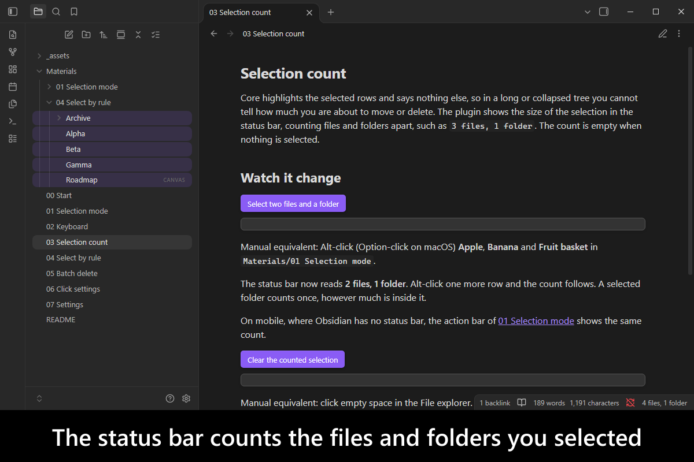
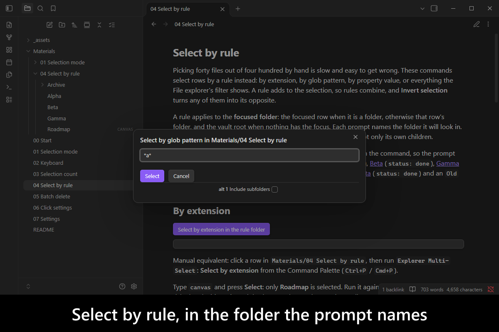
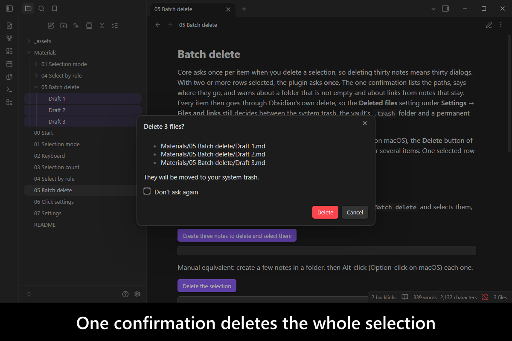
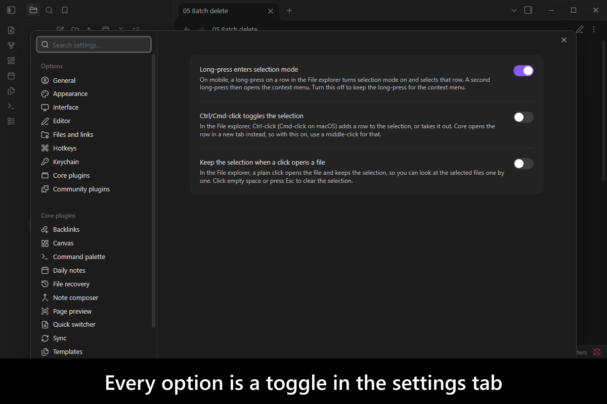
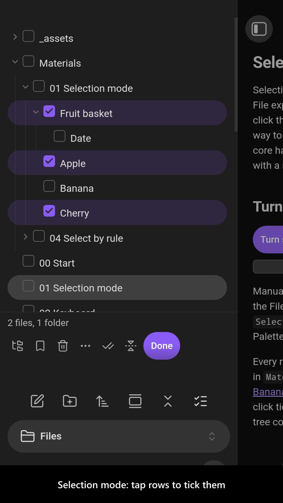
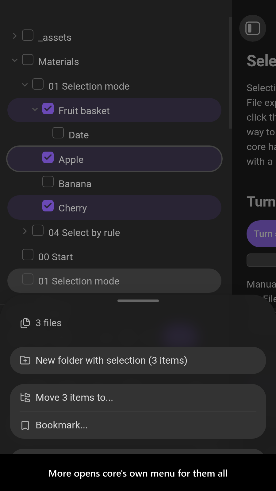
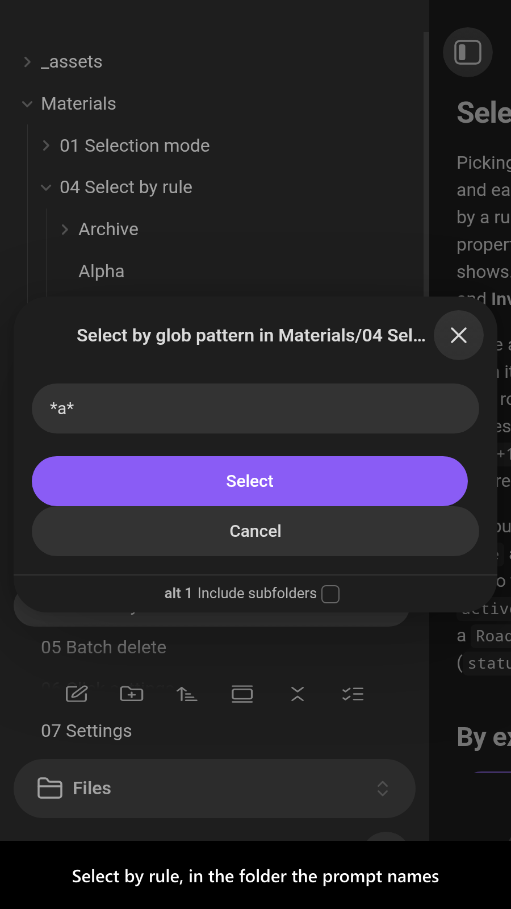
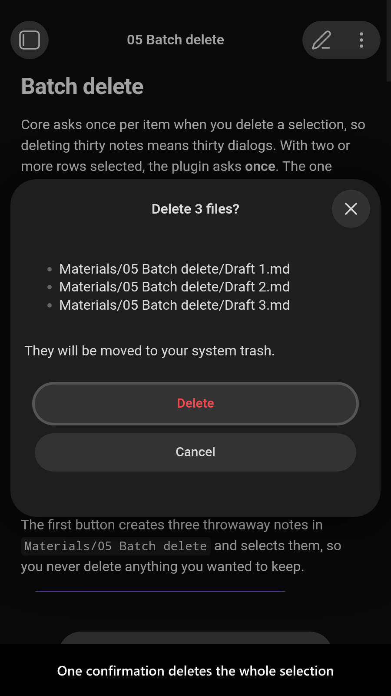
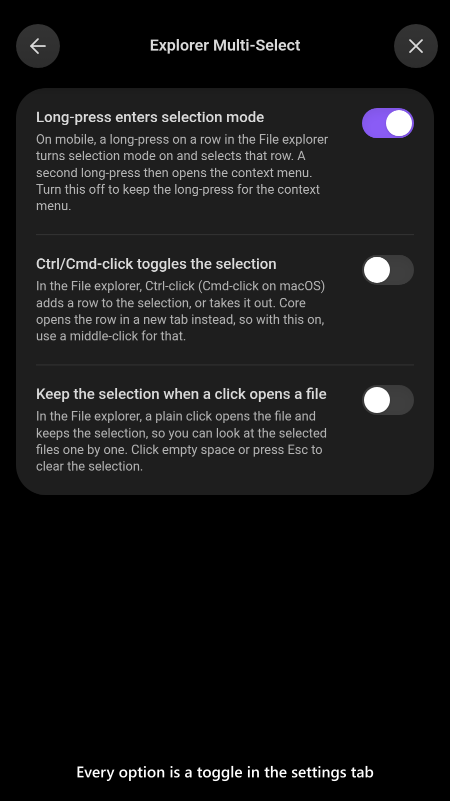

# Explorer Multi-Select

   

Selecting several files and folders in [Obsidian](https://obsidian.md/)'s File explorer is hard. On desktop you get Alt-click and Shift-click, a Shift+Up/Down range that only ever grows, no Select all, and one dialog per item when you delete. On a phone or a tablet you get no multi-select at all.

`Explorer Multi-Select` fixes that inside the File explorer you already use, rather than replacing it with a view of its own. It adds a selection mode with checkboxes and an action bar for touch, the missing keyboard keys, commands that select by extension, glob pattern, property value or the explorer's filter, a count in the status bar, and one confirmation for a batch delete. Moving, bookmarking and link updating stay core's own, so they behave exactly as they always have.

<!-- markdownlint-disable MD033 -->

More screenshots

<!-- markdownlint-enable MD033 -->

## Demo vault

**The documentation is an interactive demo vault.** Every feature has a note that explains what it does and why you would want it, with buttons that select rows, run the commands and flip the settings, so you can watch it happen.

**[Start reading here](<./demo-vault/00 Start.md>)** — it is plain markdown, so it works on GitHub with nothing installed.

A copy of the vault ships with every release. You can access it via any of the following:

1. Running the **`Explorer Multi-Select`: Open demo vault** command.
2. Downloading `explorer-multi-select-demo-vault.zip` from the [Releases](https://github.com/mnaoumov/obsidian-explorer-multi-select/releases). It unzips into a single `explorer-multi-select-demo-vault-<version>` folder.
3. Browsing its source in [`demo-vault/`](./demo-vault/README.md) in this repository.

## What it does

- **Selection mode** puts a checkbox on every row and an action bar under the tree, with Move, Bookmark, Delete, More actions, Select all, Invert selection, Clear selection and Done. A tap toggles a row instead of opening it. On mobile, a long-press turns it on. [01 Selection mode](<./demo-vault/01 Selection mode.md>)
- **Keyboard selection**: `Ctrl+A` / `Cmd+A` selects the focused folder's rows, `Space` toggles the focused row, `Shift+Space` clears the selection, and a `Shift+Up` / `Shift+Down` range shrinks when you reverse direction. [02 Keyboard](<./demo-vault/02 Keyboard.md>)
- **A selection count** in the status bar, such as `12 files, 3 folders`. [03 Selection count](<./demo-vault/03 Selection count.md>)
- **Select by rule**: commands that select by extension, by glob pattern, by property value, or every file the explorer's filter shows, in the focused folder or everything under it, and a command that inverts the selection. [04 Select by rule](<./demo-vault/04 Select by rule.md>)
- **One confirmation for a batch delete**, from the Delete key, the action bar or core's context menu. Each item still goes through Obsidian's own delete, so the **Deleted files** setting holds. [05 Batch delete](<./demo-vault/05 Batch delete.md>)
- **Two opt-in click settings**: Ctrl/Cmd-click toggles a row, and a plain click keeps the selection while it opens a file. [06 Click settings](<./demo-vault/06 Click settings.md>)

## See also

[My other Obsidian resources](https://github.com/mnaoumov/obsidian-resources)

| Plugin | Features | How `Explorer Multi-Select` differs |
| --- | --- | --- |
| [`Column Explorer`](https://community.obsidian.md/plugins/column-explorer) | Miller-column file manager; multi-select | Same selection goal; keeps core tree; touch selection mode and rule-based commands |
| [`File Commander`](https://community.obsidian.md/plugins/file-commander) | Separate batch-file list; folder/tag filters; delete/move/tag/rename; link/image cleanup | Different surface: changes selection inside core File explorer |
| [`Notebook Navigator`](https://community.obsidian.md/plugins/notebook-navigator) | Dedicated dual-pane browser; previews; calendar; keyboard multi-select | Same selection goal; extends core File explorer rather than replacing it |
| [`Sidebar Keyboard Navigation`](https://community.obsidian.md/plugins/sidebar-keyboard-navigation) | Vim-like core-explorer keys; selection toggle/clear; delete selection | Broader selection controls: touch mode, rule commands and selection count |
| [`Yazi Explorer`](https://community.obsidian.md/plugins/yazi-explorer) | On-demand keyboard explorer; Miller columns; preview/search; multi-select | Same selection goal; works in core File explorer; touch support |

Last searched for similar plugins on 2026-10-26.

## Installation

The plugin is available in [the official Community Plugins repository](https://community.obsidian.md/plugins/explorer-multi-select).

### Beta versions

To install the latest beta release of this plugin (regardless if it is available in [the official Community Plugins repository](https://community.obsidian.md) or not), follow these steps:

1. Ensure you have the [BRAT plugin](https://community.obsidian.md/plugins/obsidian42-brat) installed and enabled.
2. Click [Install via BRAT](https://intradeus.github.io/http-protocol-redirector?r=obsidian://brat?plugin=https://github.com/mnaoumov/obsidian-explorer-multi-select).
3. An Obsidian pop-up window should appear. In the window, click the `Add plugin` button once and wait a few seconds for the plugin to install.

## Debugging

By default, debug messages for this plugin (id: `explorer-multi-select`) are hidden.

If you need to enable them refer to the [documentation](https://mnaoumov.dev/obsidian-lib/guides/debugging/).

## Changelog

All notable changes to this project will be documented in the [CHANGELOG](./CHANGELOG.md).

## Contributing

Contributions are welcome — see [CONTRIBUTING](./CONTRIBUTING.md) to get set up.

## Support

<!-- markdownlint-disable MD033 -->

<!-- markdownlint-enable MD033 -->

## License

© [Michael Naumov](https://github.com/mnaoumov/)
